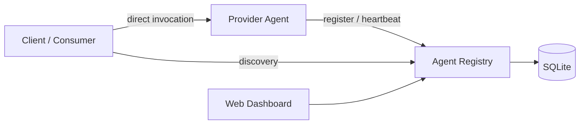

# Agent Registry

Agent Registry là dịch vụ **đăng ký và khám phá Agent** trong một hệ thống phân tán. Mỗi Provider Agent có thể đăng ký `Agent Card`, công bố các `capabilities` và `endpoint`, duy trì trạng thái bằng heartbeat; Client có thể tìm Agent phù hợp rồi gọi trực tiếp tới endpoint của Agent đó.

Project được xây dựng cho học phần **Hệ thống phân tán**, sử dụng Python, FastAPI và SQLite.

## Tính năng chính

- Đăng ký và quản lý Agent Card.
- Tìm kiếm Agent theo `domain` và `capability`.
- Theo dõi trạng thái Agent bằng heartbeat và lease.
- Cập nhật endpoint động mà không thay đổi Agent ID.
- Credential riêng để bảo vệ quyền sở hữu Agent ID.
- Web Dashboard để đăng ký, tìm kiếm và quản lý Agent.
- REST API cho Agent viết bằng bất kỳ ngôn ngữ nào.
- Python SDK hỗ trợ lifecycle, discovery và invocation.

## Kiến trúc



Registry chịu trách nhiệm về **directory, discovery và lifecycle metadata**. Business request không đi qua Registry:

```text
Client
   │
   │ discover capability
   ▼
Registry
   │
   │ provider + endpoint
   ▼
Client ───────────────► Provider Agent
        direct call
```

Registry **không phải** Message Broker, API Gateway hay multi-agent orchestrator.

## Cấu trúc repository

```text
agent-registry/
├── registry/                 # Registry server, REST API và Web Dashboard
├── agent_registry_client/    # Python SDK cho Provider/Consumer
├── demo/                     # Weather, News và các client mẫu
├── docs/                     # Tài liệu kiến trúc và tích hợp
├── tests/                    # Automated tests
├── scripts/                  # Smoke/integration tests
├── requirements.txt
└── README.md
```

## Bắt đầu

### 1. Clone repository

```bash
git clone https://github.com/HPHind110/agent-registry.git
cd agent-registry
```

### 2. Tạo môi trường Python

Yêu cầu Python **3.11+**.

PowerShell:

```powershell
python -m venv .venv
.\.venv\Scripts\Activate.ps1
python -m pip install -r requirements.txt
```

### 3. Khởi động Agent Registry

```powershell
python -m uvicorn registry.main:app --port 8000
```

Sau khi server chạy:

- **Web Dashboard:** http://127.0.0.1:8000/
- **Swagger API:** http://127.0.0.1:8000/docs
- **Health check:** http://127.0.0.1:8000/v1/health

Dữ liệu Registry mặc định được lưu trong SQLite tại `registry.db`.

## Web Dashboard

Web Dashboard là giao diện chính dành cho người quản lý và demo hệ thống.

### Đăng ký Agent

Chọn **Đăng ký Agent** và khai báo:

- Agent ID
- Name
- Domain
- Capabilities
- Endpoint
- Version
- Description

Ví dụ:

```text
Agent ID:      weather-agent-01
Domain:        weather
Capabilities: weather_forecast
Endpoint:      http://192.168.1.20:8001/forecast
Version:       1.0
```

Khi tạo Agent ID mới, Registry cấp một **credential** dùng để chứng minh quyền sở hữu Agent đó. Credential cần được lưu lại để cập nhật, re-register hoặc xóa registration sau này.

> Đăng ký Agent Card trên Web chỉ khai báo Agent với Registry. Nó **không khởi động chương trình Agent** và Web Dashboard cũng **không gửi heartbeat thay Agent**.

### Tìm kiếm Agent

Danh bạ hỗ trợ lọc theo:

- `Capability`
- `Domain`
- trạng thái hoạt động

Ví dụ Client cần capability `weather_forecast`, Registry có thể trả về một hoặc nhiều Provider Agent đang cung cấp capability đó cùng endpoint tương ứng.

### Quản lý Agent

Từ Dashboard có thể:

- xem Agent Card;
- xem endpoint hiện tại;
- xem heartbeat và lease;
- xem trạng thái Agent;
- cập nhật metadata;
- re-register;
- xóa registration.

## Agent lifecycle

Một Provider Agent thông thường có vòng đời:

```text
Start Agent
    │
    ▼
Register Agent Card
    │
    ▼
  ONLINE
    │
    │ heartbeat
    ├───────────────┐
    │               │
    ▼               │
  ONLINE ◄──────────┘
    │
    │ mất heartbeat
    ▼
  SUSPECT
    │
    │ lease hết hạn
    ▼
UNREACHABLE
```

Nếu Agent khởi động lại với cùng `Agent ID` và credential, nó có thể re-register và cập nhật endpoint mới.

Chi tiết về state machine, lease và failure handling xem [Architecture](docs/architecture.md).

## Tích hợp Agent mới

Một Agent bên ngoài có hai cách làm việc với Registry.

### REST API

REST API không phụ thuộc ngôn ngữ lập trình.

Các thao tác chính:

| Method | Endpoint | Chức năng |
|---|---|---|
| `POST` | `/v1/agents` | Register / re-register |
| `GET` | `/v1/agents` | Discovery |
| `GET` | `/v1/agents/{agent_id}` | Lookup Agent |
| `POST` | `/v1/agents/{agent_id}/heartbeat` | Renew lease |
| `PATCH` | `/v1/agents/{agent_id}` | Update Agent Card |
| `POST` | `/v1/agents/{agent_id}/unregister` | Graceful unregister |
| `DELETE` | `/v1/agents/{agent_id}` | Xóa registration |
| `GET` | `/v1/health` | Registry health |

Chi tiết request, response và error semantics xem [API Contract](docs/api_contract.md).

### Python SDK

Package `agent_registry_client/` cung cấp helper cho:

- register;
- heartbeat tự động;
- re-registration;
- graceful shutdown;
- discovery;
- direct provider invocation.

Hướng dẫn tích hợp đầy đủ xem [Agent Integration Guide](docs/agent_integration.md).

## Discovery và Invocation

Hai khái niệm này được tách riêng.

**Discovery** trả lời:

> Agent nào cung cấp capability tôi cần, và endpoint của nó là gì?

**Invocation** là bước Client gọi trực tiếp Provider Agent sau khi discovery.

```text
Client
   │
   │ GET /v1/agents?capability=...
   ▼
Registry
   │
   │ Agent Card + endpoint
   ▼
Client
   │
   │ HTTP request
   ▼
Provider Agent
```

Registry không proxy business traffic giữa các Agent.

Quy ước invocation dùng trong các demo của repository được mô tả tại [Invocation Contract](docs/invocation_contract.md).

## Demo mẫu

Repository có một số thành phần mẫu để kiểm tra khả năng tích hợp:

| Thành phần | Vai trò |
|---|---|
| `Weather Agent` | Provider capability về thời tiết |
| `News Agent` | Provider tìm kiếm/tóm tắt tin mẫu |
| `Travel Client` | Consumer đơn giản dùng Weather |
| `Planner Client` | Consumer discovery và sử dụng nhiều Provider |

Các demo này dùng dữ liệu cố định để việc kiểm thử có kết quả ổn định. Chúng **không phải thành phần bắt buộc của Agent Registry**.

Hướng dẫn tích hợp và các scenario kiểm thử xem:

- [Agent Integration Guide](docs/agent_integration.md)
- [Verification](docs/verification.md)

## Tài liệu

| Tài liệu | Nội dung |
|---|---|
| [Architecture](docs/architecture.md) | Kiến trúc hệ thống, lifecycle và quyết định thiết kế |
| [API Contract](docs/api_contract.md) | Public REST API của Registry |
| [Agent Integration](docs/agent_integration.md) | Hướng dẫn Provider/Consumer tích hợp Registry |
| [Invocation Contract](docs/invocation_contract.md) | Quy ước gọi Provider trong demo |
| [Verification](docs/verification.md) | Test strategy và các scenario đã kiểm chứng |

## Giới hạn hiện tại

Phiên bản hiện tại tập trung vào bài toán service discovery và lifecycle trong phạm vi project môn học:

- một Registry instance với SQLite;
- chưa có Registry replication hoặc consensus;
- health dựa trên heartbeat/lease, chưa active probe endpoint;
- chưa có instance fencing cho nhiều process cùng Agent ID;
- chưa hỗ trợ credential rotation/recovery hoàn chỉnh;
- môi trường mục tiêu hiện tại là local/LAN qua HTTP;
- invocation contract trong demo là quy ước chung của project, chưa phải protocol Agent phổ quát.

Các giới hạn và quyết định thiết kế chi tiết hơn được trình bày trong [Architecture](docs/architecture.md).
