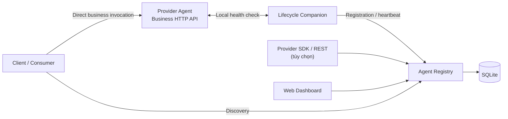
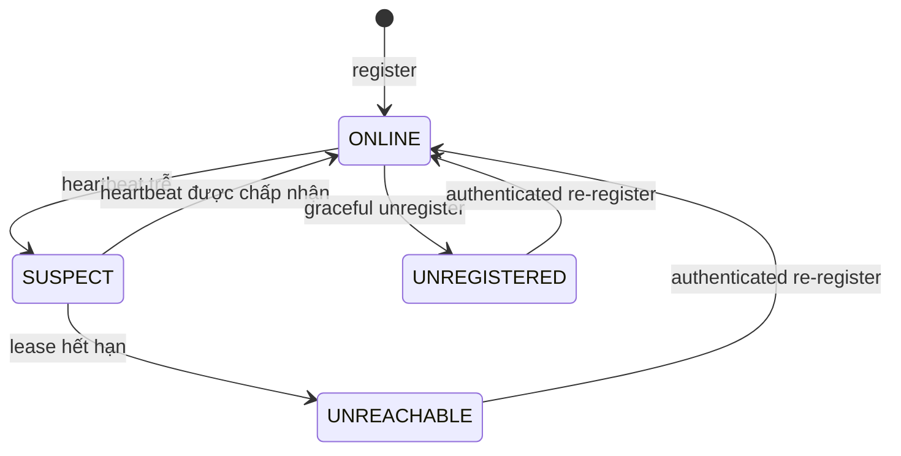

# Agent Registry

Agent Registry là dịch vụ **đăng ký, khám phá và theo dõi vòng đời các Agent** trong một hệ thống phân tán. Mỗi Provider công bố thông tin về khả năng và địa chỉ truy cập thông qua *Agent Card*. Client tra cứu Agent phù hợp theo domain/capability, sau đó gửi yêu cầu nghiệp vụ trực tiếp tới Provider.

Dự án được xây dựng cho học phần **Hệ thống phân tán** bằng Python, FastAPI, SQLAlchemy và SQLite. Registry tập trung vào **service discovery và lifecycle metadata**; nó không thay thế Message Broker, API Gateway hay hệ thống điều phối Agent.

**Dịch vụ đang triển khai:** [Dashboard HTTPS](https://103-180-134-53.sslip.io/) · [Swagger / OpenAPI](https://103-180-134-53.sslip.io/docs) · [Companion v1.0](https://github.com/HPHind110/agent-registry/releases/tag/companion-v1.0.0)

## 1. Chức năng chính

| Chức năng | Mô tả |
|---|---|
| **Registration** | Đăng ký Agent Card gồm ID, tên, domain, capabilities, endpoint và version. |
| **Discovery** | Tìm Provider theo domain, capability và trạng thái hoạt động. |
| **Lifecycle** | Theo dõi heartbeat, lease, trạng thái `ONLINE`, `SUSPECT`, `UNREACHABLE`, `UNREGISTERED`. |
| **Ownership** | Bảo vệ Agent ID bằng credential riêng; tạo ID mới trên production cần Join Token. |
| **Dynamic endpoint** | Cập nhật địa chỉ Provider mà không đổi Agent ID. |
| **Web Dashboard** | Đăng ký, tra cứu, cập nhật Agent Card và xem trạng thái. |
| **Lifecycle Companion** | Công cụ độc lập duy trì registration/heartbeat cho HTTP Agent mà không sửa source. |
| **REST API và Python SDK** | Hai cách tích hợp tùy chọn cho developer cần kiểm soát sâu hơn. |

### Kiến trúc và ranh giới trách nhiệm



- **Registry** lưu Agent Card, xác minh quyền sở hữu, suy luận trạng thái theo lease và trả kết quả discovery. Registry **không** chuyển tiếp business requests.
- **Provider** triển khai API và quyết định cách kiểm tra sức khỏe, xác thực nghiệp vụ, định dạng request/response.
- **Companion** chạy cạnh Provider, dùng file cấu hình và credential đã cấp để tự re-register, heartbeat và phục hồi trạng thái; có thể thay bằng SDK/REST tự tích hợp.
- **Consumer** hỏi Registry để nhận endpoint, sau đó kết nối trực tiếp tới Provider theo giao thức nghiệp vụ mà hai bên đã thống nhất.

Một Agent có thể vừa là Provider, vừa là Consumer. Consumer chỉ đi tìm dịch vụ thì **không bắt buộc đăng ký** vào Registry.

## 2. Truy cập Registry và chọn mô hình sử dụng

| Nhu cầu | Cách truy cập | Dữ liệu |
|---|---|---|
| **Đăng ký hoặc discovery trên hệ thống chung** | [https://103-180-134-53.sslip.io/](https://103-180-134-53.sslip.io/) | Database của Registry VPS |
| **Phát triển/kiểm thử Registry độc lập** | `http://127.0.0.1:8000/` sau khi tự khởi chạy source | SQLite local, **khác** VPS |
| **Vận hành Registry production** | SSH vào VPS để xem service/log và backup; người dùng vẫn gọi HTTPS | SQLite bền vững trên VPS |

Dashboard (`/`), Swagger (`/docs`) và REST API (`/v1/...`) là các đường dẫn của **cùng một ứng dụng FastAPI**. Dịch vụ production dùng **HTTPS qua Caddy**, chuyển tiếp đến Uvicorn chạy trên loopback và được `systemd` quản lý.

**Không cần clone repository hoặc mở SSH tunnel để sử dụng Registry chung.** Clone repository rồi chạy local tạo **một Registry khác**, không tự kết nối với dữ liệu VPS. Chi tiết quản trị: [Deployment & Operations](docs/deployment.md).

## 3. Provider: đăng ký một HTTP Agent đã có

Cách được khuyến nghị là **Web Dashboard + Registry Lifecycle Companion**. Nhóm Provider có thể dùng Python, Node.js, Go, Java hoặc framework bất kỳ, miễn là đã có HTTP API hoạt động và một URL kiểm tra trạng thái đáng tin cậy. Không cần chỉnh sửa source Agent để nhúng Registry SDK.

### Bước 1 — Chuẩn bị Agent Card

Ví dụ một Provider cung cấp chức năng dự báo:

```json
{
  "agent_id": "weather-team-a",
  "name": "Weather Agent",
  "domain": "weather",
  "description": "Weather forecast provider",
  "capabilities": ["weather_forecast"],
  "endpoint": "http://192.168.1.20:8001/forecast",
  "version": "1.0"
}
```

- `agent_id`: định danh ổn định và duy nhất của Provider.
- `domain` và `capabilities`: thông tin cho phép Consumer lọc và khám phá.
- `endpoint`: **URL nghiệp vụ đầy đủ** mà Consumer sẽ gọi, không phải URL Dashboard hoặc URL heartbeat.
- `version`: phiên bản dịch vụ do Provider công bố.

**Quan trọng:** endpoint phải truy cập được **từ máy Consumer**. Địa chỉ `127.0.0.1` luôn chỉ máy đang thực hiện request, nên chỉ phù hợp khi Client và Provider cùng máy. Registry không tự tạo tunnel, mở firewall hay kiểm tra NAT.

### Bước 2 — Đăng ký qua Dashboard

1. Bật HTTP Agent theo hướng dẫn của nhóm phát triển.
2. Mở [Registry Dashboard](https://103-180-134-53.sslip.io/) → **Đăng ký Agent**, nhập các trường của Agent Card.
3. Khi tạo **Agent ID mới**, nhập **Join Token** được nhóm vận hành cấp qua kênh riêng. ID đã tồn tại cần **ownership credential** tương ứng để đăng ký lại.
4. Sau khi tạo mới thành công, tải **credential** và **cấu hình JSON** do Dashboard cung cấp. Đặt hai file cạnh nhau trong một thư mục riêng tư, **ngoài Git repository**.

Join Token chỉ kiểm soát việc tạo ID mới; **không thay thế** ownership credential của một Agent đã đăng ký. Credential không được chia sẻ với Consumer hay đưa vào source code.

### Bước 3 — Chạy Lifecycle Companion

1. Tải asset **`registry-companion-kit.zip`** tại [GitHub Release v1.0](https://github.com/HPHind110/agent-registry/releases/tag/companion-v1.0.0), giải nén toàn bộ vào một thư mục có quyền ghi. Máy cần **Python 3.11+**.
2. Bật Agent và xác định **health URL**: ví dụ `http://127.0.0.1:8001/health`, trả HTTP 2xx khi Agent hoạt động và sẵn sàng.
3. **Windows:** mở `registry-companion-start.cmd`. **Linux:** chạy `sh ./registry-companion-start.sh`.
4. Chọn file JSON, nhập health URL. Launcher kiểm tra trước, lưu profile và tạo file khởi động riêng cho Agent.
5. Đợi thông báo `registration ONLINE` và các dòng `Heartbeat accepted`. Giữ Companion chạy cùng Agent; ở những lần tiếp theo có thể mở launcher riêng mà không nhập lại cấu hình.

Companion phát hiện health lỗi, ngừng heartbeat và cố gắng unregister; khi Provider phục hồi, nó tự re-register bằng credential cũ. **Mỗi Agent ID chỉ nên có một thành phần quản lý lifecycle** — không chạy Companion và SDK heartbeat đồng thời cho cùng ID.

Hướng dẫn đầy đủ cho Provider và xử lý lỗi: **[Companion Onboarding](docs/companion_onboarding.md)**. Provider muốn tích hợp sâu có thể dùng [REST API hoặc Python SDK](docs/agent_integration.md).

## 4. Consumer: discovery và invocation

Client không cần Join Token hay ownership credential để tra cứu danh bạ:

```http
GET /v1/agents?domain=weather&capability=weather_forecast
```

Ví dụ trên Windows PowerShell:

```powershell
$registry = "https://103-180-134-53.sslip.io"
$providers = Invoke-RestMethod "$registry/v1/agents?capability=weather_forecast"
$providers | Select-Object agent_id, status, endpoint
```

Mặc định, `GET /v1/agents` chỉ trả các Provider đang `ONLINE`. Có thể sử dụng `active_only=false` khi cần xem cả những registration không hoạt động. Một capability có thể có **nhiều Provider**, nên Consumer cần chọn một endpoint phù hợp, đặt timeout và xử lý lỗi.

**Discovery không phải Invocation.** Registry chỉ cho biết *Agent nào làm gì và ở đâu*, không tự cung cấp HTTP method, input/output schema hay token nghiệp vụ của Provider. Sau discovery, Consumer gọi **trực tiếp** URL trong Agent Card theo contract mà Provider công bố; không gửi credential của Registry vào request nghiệp vụ.

Các demo trong repository có một quy ước `POST` JSON riêng để kiểm thử interoperability. Quy ước đó **không bắt buộc** cho mọi nhóm. Xem [Invocation Contract](docs/invocation_contract.md).

## 5. Lifecycle và trạng thái



Mặc định Registry cấu hình heartbeat mỗi **10 giây**, bắt đầu nghi ngờ sau **20 giây** và lease hết hạn sau **30 giây**. Các giá trị có thể thay đổi theo cấu hình server.

| Trạng thái | Ý nghĩa |
|---|---|
| `ONLINE` | Heartbeat còn mới và lease còn hiệu lực. |
| `SUSPECT` | Heartbeat bị trễ nhưng lease chưa hết hạn. |
| `UNREACHABLE` | Lease đã hết hạn; không đồng nghĩa Provider process chắc chắn đã chết. |
| `UNREGISTERED` | Provider chủ động rút đăng ký nhưng vẫn giữ ID và ownership. |

Graceful unregister bằng `POST /v1/agents/{id}/unregister` **khác** `DELETE /v1/agents/{id}`: thao tác DELETE xóa luôn registration và ownership. Refresh Dashboard hay GET discovery không gia hạn lease.

## 6. Chạy Registry local để phát triển

Yêu cầu **Python 3.11+** và Git. Ví dụ trên Windows PowerShell:

```powershell
git clone https://github.com/HPHind110/agent-registry.git
cd agent-registry
py -3 -m venv .venv
.\.venv\Scripts\python -m pip install -r requirements.txt
$env:REGISTRY_ALLOW_OPEN_REGISTRATION = "1"  # Chỉ cho môi trường local khép kín
.\.venv\Scripts\python -m uvicorn registry.main:app --host 127.0.0.1 --port 8000
```

Địa chỉ local: [Dashboard](http://127.0.0.1:8000/) · [Swagger](http://127.0.0.1:8000/docs) · [Health](http://127.0.0.1:8000/v1/health).

Dữ liệu mặc định được ghi tại `./registry.db` trong thư mục làm việc. **Không bật open registration trên Registry công khai.** Việc cập nhật, khởi động lại và backup dịch vụ VPS được mô tả riêng trong [Deployment](docs/deployment.md).

## 7. Cấu trúc repository

```text
agent-registry/
├── registry/                 # FastAPI, Dashboard, routes, service, SQLite
├── agent_registry_client/    # Python SDK: lifecycle, discovery, invocation
├── companion/                # Logic của Lifecycle Companion
├── downloads/                # Bản .pyz, launcher và ZIP phát hành
├── demo/                     # Weather/News Providers và Travel/Planner Consumers
├── docs/                     # Tài liệu chuyên sâu
├── scripts/                  # Build Companion và smoke tests
├── tests/                    # Automated tests
├── requirements.txt
└── README.md
```

Demos sử dụng dữ liệu nghiệp vụ mẫu và không phải thành phần bắt buộc để tích hợp Registry. Để chạy toàn bộ kiểm thử:

```powershell
.\.venv\Scripts\python -m pytest -q
node --test tests/dashboard.test.cjs
```

Node.js chỉ cần cho bài test Dashboard, không bắt buộc để chạy Registry.

## 8. Tài liệu tham khảo

| Tài liệu | Đối tượng / nội dung |
|---|---|
| [Companion Onboarding](docs/companion_onboarding.md) | Provider cần tích hợp mà không sửa source Agent. |
| [Agent Integration](docs/agent_integration.md) | Provider/Consumer muốn dùng REST, Python SDK hoặc tích hợp nâng cao. |
| [API Contract](docs/api_contract.md) | Endpoints, Agent Card, authentication, lease, HTTP errors. |
| [Architecture](docs/architecture.md) | Thiết kế hệ thống, data model, lifecycle và failure recovery. |
| [Invocation Contract](docs/invocation_contract.md) | Quy ước gọi API của các Provider demo và giới hạn interoperability. |
| [Deployment & Operations](docs/deployment.md) | HTTPS, VPS, Caddy, systemd, SQLite, backup và cập nhật an toàn. |
| [Verification](docs/verification.md) | Unit/integration tests, smoke tests và phạm vi đã kiểm chứng. |

## 9. Giới hạn hiện tại

Phiên bản hiện tại vận hành một Registry instance trên SQLite, chưa có replication/consensus, distributed instance fencing, credential recovery/rotation đầy đủ hoặc rate limiting theo nhóm. Registry không tự probe business endpoint và không bảo đảm cross-network reachability. Companion chỉ kiểm tra health **từ máy Provider**; HTTP method, business authentication và input/output schema vẫn do Provider/Consumer thống nhất.

Registry HTTPS và lifecycle Companion đã được kiểm thử với các Agent độc lập trên Windows; điều đó **chưa** thay thế kiểm thử giao tiếp nghiệp vụ thực tế giữa nhiều máy, nhiều nhóm hoặc kiểm thử tải production.
