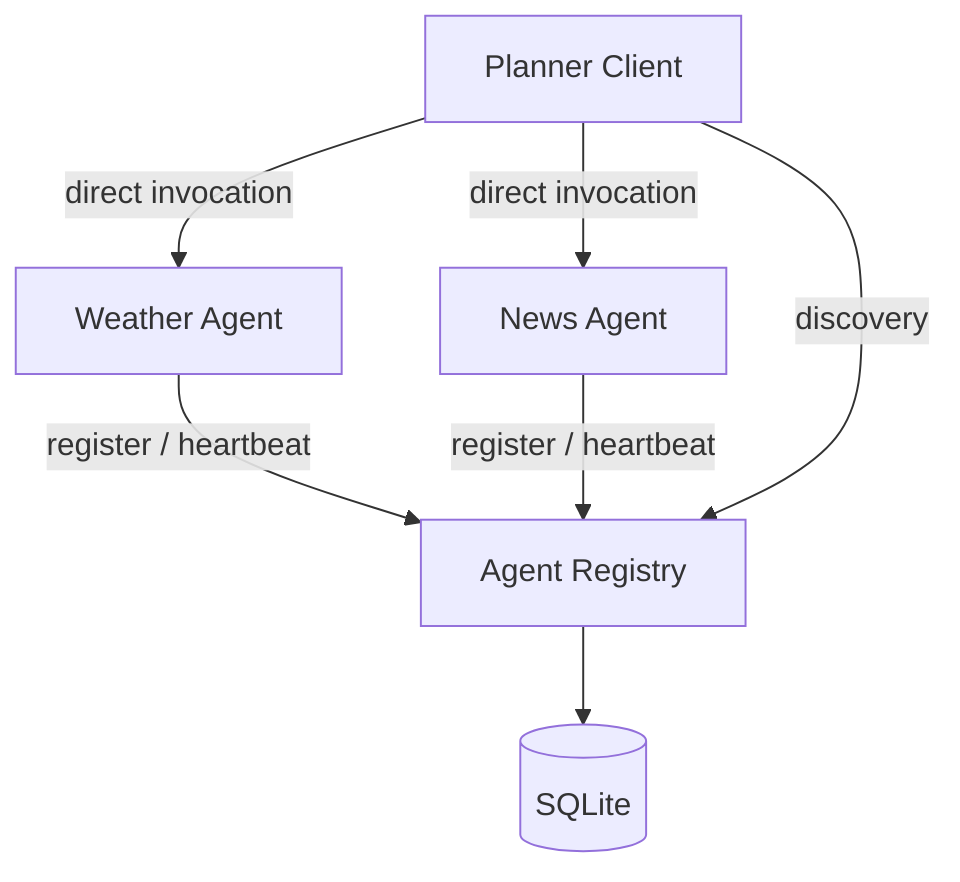

# Agent Registry

Agent Registry là dịch vụ danh bạ cho các Agent độc lập: lưu Agent Card (metadata mô tả dịch vụ), tìm provider theo domain/capability và theo dõi heartbeat bằng lease. Client lấy endpoint từ Registry rồi gọi trực tiếp Provider Agent. Đây là project môn Hệ thống phân tán, sử dụng Python, FastAPI và SQLite.

## 1. Mục tiêu

- Đăng ký động và giữ Agent ID ổn định khi endpoint thay đổi (binding).
- Discovery nhiều provider theo domain (lĩnh vực) và capability (chức năng).
- Duy trì registration bằng heartbeat do chính Provider Agent gửi.
- Bảo vệ quyền sửa registration bằng credential riêng của từng Agent ID.
- Cho phép nhóm ngoài tích hợp qua REST hoặc Python SDK.

Registry không chạy Agent, không heartbeat thay Agent, không xử lý business request như Message Broker/API Gateway và không điều phối multi-agent. Hiện chưa có replication/consensus.

## 2. Kiến trúc tổng quan



Registry lưu card, ownership và thời hạn lease. Provider Agent cung cấp HTTP API nghiệp vụ; Client / Consumer tìm và sử dụng API đó. SDK hỗ trợ lifecycle phía provider, discovery và quy ước invocation phía consumer. Dashboard là giao diện quan sát/quản lý cùng Registry.

## 3. Luồng hoạt động chính

1. Provider khởi động, tạo Agent Card từ cấu hình.
2. Provider đăng ký hoặc re-register bằng credential đã lưu.
3. Task nền của provider tự heartbeat để Registry renew lease; business API chạy song song.
4. Consumer discovery capability cần dùng; mặc định chỉ nhận provider `ONLINE`.
5. Consumer gọi **endpoint nhận được** trực tiếp và xử lý response/lỗi theo contract đã thống nhất.

TTL không giới hạn thời gian chạy Agent: heartbeat đều duy trì registration qua nhiều chu kỳ lease. `ONLINE` phản ánh tín hiệu gần đây, không bảo đảm endpoint truy cập được từ mọi client.

## 4. Các thành phần trong repository

| Thành phần | Vai trò |
|---|---|
| `registry/` | REST API, service, SQLite, lease/status và dashboard |
| `agent_registry_client/` | SDK lifecycle, discovery và invocation |
| `demo/weather_agent.py` | Provider thời tiết với dữ liệu cố định |
| `demo/news_agent.py` | Provider tìm tin mẫu và trích câu đầu để tóm tắt |
| `demo/travel_client.py` | Consumer cũ: discovery Weather rồi gọi GET |
| `demo/planner_client.py` | Consumer gọi Weather và News, tổng hợp kết quả complete/partial |
| `tests/`, `scripts/` | Automated tests và smoke test bằng process/HTTP thật |
| `docs/` | Kiến trúc, contract, tích hợp và kiểm chứng |

## 5. Quick Start — PowerShell

Cần Python **3.11+**. Node.js chỉ cần nếu chạy test dashboard. Từ thư mục repository:

```powershell
Set-Location C:\agent-registry
python -m venv .venv
.\.venv\Scripts\python -m pip install -r requirements.txt
```

Mở bốn terminal, chạy `Set-Location C:\agent-registry` trong mỗi terminal. `.env.example` là tài liệu cấu hình, **không tự nạp**; đặt biến bằng `$env:`. Chạy một process cho mỗi Agent ID, không thêm `--workers` hoặc tắt lifespan.

### Terminal 1 — Registry

```powershell
$env:REGISTRY_HEARTBEAT_SECONDS = '10'
$env:REGISTRY_SUSPECT_SECONDS = '20'
$env:REGISTRY_TTL_SECONDS = '30'
.\.venv\Scripts\python -m uvicorn registry.main:app --port 8000
```

### Terminal 2 — Weather

```powershell
$env:REGISTRY_URL = 'http://127.0.0.1:8000'
$env:WEATHER_AGENT_ID = 'weather-local'
$env:WEATHER_ENDPOINT = 'http://127.0.0.1:8001/forecast'
$env:WEATHER_CREDENTIAL_FILE = 'weather.credential'
.\.venv\Scripts\python -m uvicorn demo.weather_agent:app --port 8001
```

### Terminal 3 — News

```powershell
$env:REGISTRY_URL = 'http://127.0.0.1:8000'
$env:NEWS_AGENT_ID = 'news-agent-01'
$env:NEWS_ENDPOINT = 'http://127.0.0.1:8002/invoke'
$env:NEWS_CREDENTIAL_FILE = 'news.credential'
.\.venv\Scripts\python -m uvicorn demo.news_agent:app --port 8002
```

### Terminal 4 — Planner

Chờ hai provider báo đăng ký thành công, rồi chạy:

```powershell
$env:REGISTRY_URL = 'http://127.0.0.1:8000'
.\.venv\Scripts\python -m demo.planner_client --city Hanoi
```

Kết quả mong đợi: `status: complete`, `weather` có nhiệt độ 26, `news` có hai tin mẫu, `providers_used` ghi hai provider và `errors: {}`. Planner chạy xong rồi thoát; ba terminal server tiếp tục chạy. Consumer cũ chạy bằng `.\.venv\Scripts\python -m demo.travel_client --city Hanoi`.

Giữ file credential qua các lần restart. Nếu ID đã được đăng ký trên web hoặc bằng bản chạy khác, cần đúng credential của ID đó; xem [hướng dẫn tích hợp](docs/agent_integration.md).

## 6. Registry API — tóm tắt

| Method | Route | Mục đích |
|---|---|---|
| POST | `/v1/agents` | Register / authenticated re-registration |
| GET | `/v1/agents` | Discovery theo capability/domain; mặc định chỉ ONLINE |
| GET | `/v1/agents/{agent_id}` | Lookup ID, kể cả registration không ONLINE |
| PATCH | `/v1/agents/{agent_id}` | Sửa card, không renew lease |
| POST | `/v1/agents/{agent_id}/heartbeat` | Renew lease còn hiệu lực |
| GET | `/v1/agents/{agent_id}/status` | Xem trạng thái suy luận |
| POST | `/v1/agents/{agent_id}/unregister` | Rút registration, giữ ownership |
| DELETE | `/v1/agents/{agent_id}` | Xóa record và giải phóng ID |
| GET | `/v1/health` | Kiểm tra Registry và kết nối DB |

Thử API tại [Swagger UI](http://127.0.0.1:8000/docs); schema và quy tắc đầy đủ nằm trong [API Contract](docs/api_contract.md).

## 7. Failure & Recovery demo

- **Provider crash:** dùng Task Manager kết thúc đúng PID Weather trong log Uvicorn; Ctrl+C là graceful shutdown, không phải crash. Sau heartbeat cuối, Registry suy luận `ONLINE → SUSPECT → UNREACHABLE`. Normal discovery loại provider ngay từ SUSPECT; Planner vẫn trả News với `status: partial`.
- **Provider recovery:** giữ ID/file credential, đặt `WEATHER_ENDPOINT` thành `http://127.0.0.1:9005/forecast`, chạy lại Weather với `--port 9005`. Re-registration cập nhật binding; Planner lần chạy tiếp theo lấy endpoint mới.
- **Registry outage:** dừng Registry, giữ hai provider chạy. Business API vẫn phục vụ; SDK retry. Bật Registry với cùng DB, provider tự reconnect/re-register khi cần. Không reset DB trong demo này.

## 8. Web Dashboard

Mở [Dashboard](http://127.0.0.1:8000/) để xem card, endpoint, heartbeat cuối, lease và trạng thái. Trang đọc lại dữ liệu mỗi 5 giây khi đang hiển thị; không gửi heartbeat. Đăng ký card trên web **không khởi chạy Agent**; phải cấp credential cho chương trình provider. Nút “Hủy đăng ký” hiện thực hiện DELETE, xóa cả ownership; khác graceful `/unregister`.

## 9. Documentation

| Document | Nội dung |
|---|---|
| [Architecture](docs/architecture.md) | Thành phần, lifecycle, state machine và quyết định thiết kế |
| [API Contract](docs/api_contract.md) | Public Registry REST API |
| [Agent Integration](docs/agent_integration.md) | Tích hợp provider/consumer, cấu hình và troubleshooting |
| [Invocation Contract](docs/invocation_contract.md) | Quy ước gọi provider, Weather/News và kết quả Planner |
| [Verification](docs/verification.md) | Chiến lược test, lệnh chạy và kết quả kiểm chứng |

## 10. Current Limitations

- Một Registry instance dùng SQLite; chưa replication, phân trang hoặc benchmark tải.
- Không active probe; lease dựa trên đồng hồ Registry và không chứng minh process đã chết.
- Chưa instance fencing: hai process cùng ID/credential có thể ghi đè hoặc unregister nhau.
- Chưa credential rotation/recovery; mất credential hoặc response cấp khóa đầu tiên cần operator xử lý.
- Đọc danh bạ và đăng ký ID mới chưa có admission control; HTTP demo dành cho local/LAN tin cậy, chưa triển khai Internet production.
- Common invocation là quy ước đã thỏa thuận; Agent Card chưa mô tả schema, HTTP method hay phiên bản protocol để tự gọi mọi Agent.
- Travel cũ chưa validate schema forecast; Planner có validate output. Weather/News dùng dữ liệu mẫu.
- Chưa kiểm chứng LAN nhiều máy, tích hợp nhóm ngoài hoặc browser E2E; phạm vi đã chạy ghi trong Verification.
