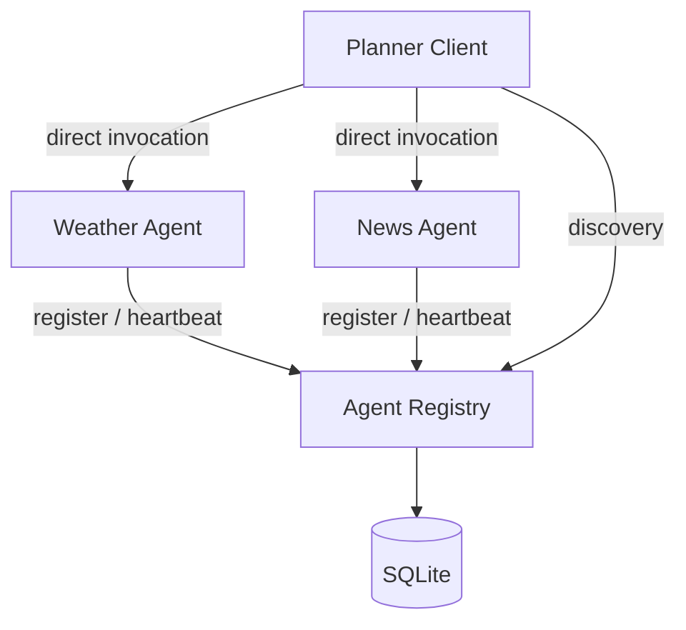

# Agent Registry

Agent Registry l� d?ch v? danh b? cho c�c Agent �?c l?p: l�u Agent Card (metadata m� t? d?ch v?), t?m provider theo domain/capability v� theo d?i heartbeat b?ng lease. Client l?y endpoint t? Registry r?i g?i tr?c ti?p Provider Agent. ��y l� project m�n H? th?ng ph�n t�n, s? d?ng Python, FastAPI v� SQLite.

## 1. M?c ti�u

- ��ng k? �?ng v� gi? Agent ID ?n �?nh khi endpoint thay �?i (binding).
- Discovery nhi?u provider theo domain (l?nh v?c) v� capability (ch?c n�ng).
- Duy tr? registration b?ng heartbeat do ch�nh Provider Agent g?i.
- B?o v? quy?n s?a registration b?ng credential ri�ng c?a t?ng Agent ID.
- Cho ph�p nh�m ngo�i t�ch h?p qua REST ho?c Python SDK.

Registry kh�ng ch?y Agent, kh�ng heartbeat thay Agent, kh�ng x? l? business request nh� Message Broker/API Gateway v� kh�ng �i?u ph?i multi-agent. Hi?n ch�a c� replication/consensus.

## 2. Ki?n tr�c t?ng quan



Registry l�u card, ownership v� th?i h?n lease. Provider Agent cung c?p HTTP API nghi?p v?; Client / Consumer t?m v� s? d?ng API ��. SDK h? tr? lifecycle ph�a provider, discovery v� quy �?c invocation ph�a consumer. Dashboard l� giao di?n quan s�t/qu?n l? c�ng Registry.

## 3. Lu?ng ho?t �?ng ch�nh

1. Provider kh?i �?ng, t?o Agent Card t? c?u h?nh.
2. Provider ��ng k? ho?c re-register b?ng credential �? l�u.
3. Task n?n c?a provider t? heartbeat �? Registry renew lease; business API ch?y song song.
4. Consumer discovery capability c?n d�ng; m?c �?nh ch? nh?n provider `ONLINE`.
5. Consumer g?i **endpoint nh?n ��?c** tr?c ti?p v� x? l? response/l?i theo contract �? th?ng nh?t.

TTL kh�ng gi?i h?n th?i gian ch?y Agent: heartbeat �?u duy tr? registration qua nhi?u chu k? lease. `ONLINE` ph?n �nh t�n hi?u g?n ��y, kh�ng b?o �?m endpoint truy c?p ��?c t? m?i client.

## 4. C�c th�nh ph?n trong repository

| Th�nh ph?n | Vai tr? |
|---|---|
| `registry/` | REST API, service, SQLite, lease/status v� dashboard |
| `agent_registry_client/` | SDK lifecycle, discovery v� invocation |
| `demo/weather_agent.py` | Provider th?i ti?t v?i d? li?u c? �?nh |
| `demo/news_agent.py` | Provider t?m tin m?u v� tr�ch c�u �?u �? t�m t?t |
| `demo/travel_client.py` | Consumer c?: discovery Weather r?i g?i GET |
| `demo/planner_client.py` | Consumer g?i Weather v� News, t?ng h?p k?t qu? complete/partial |
| `tests/`, `scripts/` | Automated tests v� smoke test b?ng process/HTTP th?t |
| `docs/` | Ki?n tr�c, contract, t�ch h?p v� ki?m ch?ng |

## 5. Quick Start � PowerShell

C?n Python **3.11+**. Node.js ch? c?n n?u ch?y test dashboard. T? th� m?c repository:

```powershell
Set-Location C:\agent-registry
python -m venv .venv
.\.venv\Scripts\python -m pip install -r requirements.txt
```

M? b?n terminal, ch?y `Set-Location C:\agent-registry` trong m?i terminal. `.env.example` l� t�i li?u c?u h?nh, **kh�ng t? n?p**; �?t bi?n b?ng `$env:`. Ch?y m?t process cho m?i Agent ID, kh�ng th�m `--workers` ho?c t?t lifespan.

### Terminal 1 � Registry

```powershell
$env:REGISTRY_HEARTBEAT_SECONDS = '10'
$env:REGISTRY_SUSPECT_SECONDS = '20'
$env:REGISTRY_TTL_SECONDS = '30'
.\.venv\Scripts\python -m uvicorn registry.main:app --port 8000
```

### Terminal 2 � Weather

```powershell
$env:REGISTRY_URL = 'http://127.0.0.1:8000'
$env:WEATHER_AGENT_ID = 'weather-local'
$env:WEATHER_ENDPOINT = 'http://127.0.0.1:8001/forecast'
$env:WEATHER_CREDENTIAL_FILE = 'weather.credential'
.\.venv\Scripts\python -m uvicorn demo.weather_agent:app --port 8001
```

### Terminal 3 � News

```powershell
$env:REGISTRY_URL = 'http://127.0.0.1:8000'
$env:NEWS_AGENT_ID = 'news-agent-01'
$env:NEWS_ENDPOINT = 'http://127.0.0.1:8002/invoke'
$env:NEWS_CREDENTIAL_FILE = 'news.credential'
.\.venv\Scripts\python -m uvicorn demo.news_agent:app --port 8002
```

### Terminal 4 � Planner

Ch? hai provider b�o ��ng k? th�nh c�ng, r?i ch?y:

```powershell
$env:REGISTRY_URL = 'http://127.0.0.1:8000'
.\.venv\Scripts\python -m demo.planner_client --city Hanoi
```

K?t qu? mong �?i: `status: complete`, `weather` c� nhi?t �? 26, `news` c� hai tin m?u, `providers_used` ghi hai provider v� `errors: {}`. Planner ch?y xong r?i tho�t; ba terminal server ti?p t?c ch?y. Consumer c? ch?y b?ng `.\.venv\Scripts\python -m demo.travel_client --city Hanoi`.

Gi? file credential qua c�c l?n restart. N?u ID �? ��?c ��ng k? tr�n web ho?c b?ng b?n ch?y kh�c, c?n ��ng credential c?a ID ��; xem [h�?ng d?n t�ch h?p](docs/agent_integration.md).

## 6. Registry API � t�m t?t

| Method | Route | M?c ��ch |
|---|---|---|
| POST | `/v1/agents` | Register / authenticated re-registration |
| GET | `/v1/agents` | Discovery theo capability/domain; m?c �?nh ch? ONLINE |
| GET | `/v1/agents/{agent_id}` | Lookup ID, k? c? registration kh�ng ONLINE |
| PATCH | `/v1/agents/{agent_id}` | S?a card, kh�ng renew lease |
| POST | `/v1/agents/{agent_id}/heartbeat` | Renew lease c?n hi?u l?c |
| GET | `/v1/agents/{agent_id}/status` | Xem tr?ng th�i suy lu?n |
| POST | `/v1/agents/{agent_id}/unregister` | R�t registration, gi? ownership |
| DELETE | `/v1/agents/{agent_id}` | X�a record v� gi?i ph�ng ID |
| GET | `/v1/health` | Ki?m tra Registry v� k?t n?i DB |

Th? API t?i [Swagger UI](http://127.0.0.1:8000/docs); schema v� quy t?c �?y �? n?m trong [API Contract](docs/api_contract.md).

## 7. Failure & Recovery demo

- **Provider crash:** d�ng Task Manager k?t th�c ��ng PID Weather trong log Uvicorn; Ctrl+C l� graceful shutdown, kh�ng ph?i crash. Sau heartbeat cu?i, Registry suy lu?n `ONLINE ? SUSPECT ? UNREACHABLE`. Normal discovery lo?i provider ngay t? SUSPECT; Planner v?n tr? News v?i `status: partial`.
- **Provider recovery:** gi? ID/file credential, �?t `WEATHER_ENDPOINT` th�nh `http://127.0.0.1:9005/forecast`, ch?y l?i Weather v?i `--port 9005`. Re-registration c?p nh?t binding; Planner l?n ch?y ti?p theo l?y endpoint m?i.
- **Registry outage:** d?ng Registry, gi? hai provider ch?y. Business API v?n ph?c v?; SDK retry. B?t Registry v?i c�ng DB, provider t? reconnect/re-register khi c?n. Kh�ng reset DB trong demo n�y.

## 8. Web Dashboard

M? [Dashboard](http://127.0.0.1:8000/) �? xem card, endpoint, heartbeat cu?i, lease v� tr?ng th�i. Trang �?c l?i d? li?u m?i 5 gi�y khi �ang hi?n th?; kh�ng g?i heartbeat. ��ng k? card tr�n web **kh�ng kh?i ch?y Agent**; ph?i c?p credential cho ch��ng tr?nh provider. N�t �H?y ��ng k?� hi?n th?c hi?n DELETE, x�a c? ownership; kh�c graceful `/unregister`.

## 9. Documentation

| Document | N?i dung |
|---|---|
| [Architecture](docs/architecture.md) | Th�nh ph?n, lifecycle, state machine v� quy?t �?nh thi?t k? |
| [API Contract](docs/api_contract.md) | Public Registry REST API |
| [Agent Integration](docs/agent_integration.md) | T�ch h?p provider/consumer, c?u h?nh v� troubleshooting |
| [Invocation Contract](docs/invocation_contract.md) | Quy �?c g?i provider, Weather/News v� k?t qu? Planner |
| [Verification](docs/verification.md) | Chi?n l�?c test, l?nh ch?y v� k?t qu? ki?m ch?ng |

## 10. Current Limitations

- M?t Registry instance d�ng SQLite; ch�a replication, ph�n trang ho?c benchmark t?i.
- Kh�ng active probe; lease d?a tr�n �?ng h? Registry v� kh�ng ch?ng minh process �? ch?t.
- Ch�a instance fencing: hai process c�ng ID/credential c� th? ghi �� ho?c unregister nhau.
- Ch�a credential rotation/recovery; m?t credential ho?c response c?p kh�a �?u ti�n c?n operator x? l?.
- �?c danh b? v� ��ng k? ID m?i ch�a c� admission control; HTTP demo d�nh cho local/LAN tin c?y, ch�a tri?n khai Internet production.
- Common invocation l� quy �?c �? th?a thu?n; Agent Card ch�a m� t? schema, HTTP method hay phi�n b?n protocol �? t? g?i m?i Agent.
- Travel c? ch�a validate schema forecast; Planner c� validate output. Weather/News d�ng d? li?u m?u.
- Ch�a ki?m ch?ng LAN nhi?u m�y, t�ch h?p nh�m ngo�i ho?c browser E2E; ph?m vi �? ch?y ghi trong Verification.

