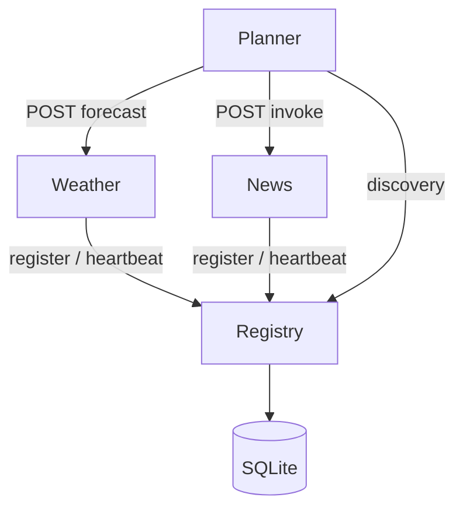

# API contract v1

Base URL ví dụ: `http://127.0.0.1:8000`. Request/response JSON UTF-8. UTC ISO-8601 có `Z` hoặc `+00:00`. OpenAPI sinh trực tiếp từ ứng dụng tại `/openapi.json`; `/docs` cho thử tương tác.

## Agent Card

```json
{
  "agent_id": "weather-team-a",
  "name": "Weather Agent",
  "domain": "weather",
  "description": "Forecast provider",
  "capabilities": ["weather_forecast"],
  "endpoint": "http://192.168.1.20:8001/forecast",
  "version": "1.0"
}
```

Tất cả trường bắt buộc khi POST; description được phép rỗng. ID phân biệt hoa thường, 1–128 ký tự ASCII chữ/số/`_ . -`, ký tự đầu là chữ/số. Name 1–200, description tối đa 1000, version 1–64 ký tự sau strip. Endpoint HTTP(S) tối đa 2048 ký tự, không user/password hoặc fragment. Không đảm bảo endpoint reachable.

Domain/capability: strip, lowercase, gom chuỗi whitespace hoặc dấu `-` thành `_`; kết quả 1–100 ký tự `[a-z0-9_.:]`, bắt đầu bằng chữ/số. Ví dụ ` Weather-Forecast ` → `weather_forecast`. Capabilities 1–100 phần tử đầu vào, loại trùng và sắp xếp. Bộ lọc dùng cùng normalization, so khớp chính xác sau chuẩn hóa. Không nhận trường thừa hoặc metadata do client tự đặt.

## Các route

| Method/path | Input | Thành công | Xác thực |
|---|---|---|---|
| POST `/v1/agents` | Agent Card đầy đủ | 201 tạo; 200 re-register | ID mới: không; ID cũ: Bearer bắt buộc |
| GET `/v1/agents` | query `capability`, `domain`, `active_only=true` | 200, mảng AgentView | Không |
| GET `/v1/agents/{id}` | ID | 200 AgentView, kể cả expired | Không |
| PATCH `/v1/agents/{id}` | Một hoặc nhiều trường card trừ ID | 200 AgentView | Bearer |
| POST `/v1/agents/{id}/heartbeat` | Không cần body | 200 AgentView | Bearer |
| GET `/v1/agents/{id}/status` | ID | 200 AgentStatus | Không |
| DELETE `/v1/agents/{id}` | ID | 204, body rỗng | Bearer |
| GET `/v1/health` | Không | 200 Health | Không |

`Authorization: Bearer <credential>` phải dùng credential của đúng ID. Không gửi secret trên query string. 401 kèm `WWW-Authenticate: Bearer`. Token lạ khi tạo ID mới cũng trả 401 để tránh hiểu nhầm ownership. ID trùng không có token hợp lệ trả 401, không overwrite.

AgentView gồm toàn bộ card và `registered_at`, `updated_at`, `last_heartbeat`, `lease_expires_at`, `status`. Không bao giờ có hash/credential trong GET, PATCH, heartbeat. AgentStatus chỉ gồm `agent_id`, `status`, `last_heartbeat`, `lease_expires_at`. Health gồm `status="ok"`, `server_time`, `heartbeat_interval_seconds`, `ttl_seconds`, sau kiểm tra DB bằng SELECT 1.

Response đăng ký gồm AgentView, `heartbeat_interval_seconds`, `ttl_seconds`. **Chỉ 201 tạo mới có `credential`**; 200 re-register không có trường này. Header `Cache-Control: no-store`. Client phải lưu secret trước khi coi đăng ký hoàn thành. Retry POST tạo mới khi đã mất response có thể nhận 401; MVP không có idempotency key hay recovery token.

Discovery trả array sắp xếp theo `agent_id` tăng dần (SQLite binary order); nhiều provider có thể cùng capability. Không có provider trả `[]`, không phải 404. `active_only=true` chỉ trả ONLINE; `active_only=false` trả cả SUSPECT/UNREACHABLE/UNREGISTERED; các filter kết hợp AND.

## Quy tắc lease

- Mặc định TTL=30s, heartbeat interval=10s; yêu cầu `0 < interval < TTL`.
- Tạo mới đặt cả registered_at, updated_at, last_heartbeat bằng server now; expiry=now+TTL.
- ONLINE khi tuổi heartbeat < suspect threshold và lease còn hạn; SUSPECT khi vượt ngưỡng suspect nhưng lease còn hạn; UNREACHABLE khi now >= expiry; UNREGISTERED khi đã rút registration.
- Heartbeat còn hạn cập nhật last_heartbeat, updated_at và expiry. Heartbeat hết hạn trả 409, không sửa DB.
- Re-register cần card đầy đủ và credential cũ: thay card, cập nhật updated_at/last_heartbeat/expiry, giữ registered_at và credential hash. Cho phép cả ONLINE và UNREACHABLE.
- PATCH không nhận ID, metadata, null, body rỗng; sửa card và updated_at, **không gia hạn lease**. Cho phép PATCH khi expired nhưng vẫn expired.
- DELETE xóa bản ghi và hash; các lookup/mutation tiếp theo trả 404. ID được phép tái sử dụng.

## Lỗi

| HTTP | Ý nghĩa |
|---|---|
| 401 | Credential thiếu/sai cho record tồn tại; không overwrite |
| 404 | Agent không tồn tại |
| 409 | Heartbeat khi lease đã hết hạn; cần re-register |
| 422 | Input không hợp lệ, query sai, trường lạ, PATCH rỗng/null |
| 503 | SQLite bận quá timeout hoặc DB tạm không truy cập được |

Lỗi nghiệp vụ: `{"detail":"..."}`. Validation Pydantic/FastAPI dùng `detail` array; validation query normalization dùng detail string. Client nên dựa vào HTTP code, không parse chuỗi tiếng Anh.

## Weather capability contract cho demo

`weather_forecast`, domain `weather`, version `1.0`: gọi **GET vào chính endpoint quảng bá**, thêm query `city` (1–100 ký tự, mặc định Hanoi). Không tự nối `/forecast` vì card đã chứa full route. Response 200:

```json
{"city":"Hanoi","temperature_c":26,"condition":"partly_cloudy","source":"demo_static_data"}
```

Registry không ép schema này cho capability khác. Các nhóm cần thỏa thuận phương thức, payload, lỗi và version của từng capability. Travel timeout 5s/request, không follow redirect, thử provider tiếp theo nếu lỗi HTTP/network/JSON; hết provider trả exit code 1.

## Lifecycle extension

POST `/v1/agents/{id}/unregister`: Bearer bắt buộc, trả 200 AgentView với status UNREGISTERED; giữ card, hash credential, registered_at; cập nhật updated_at và expiry=now. Lặp lại an toàn. Heartbeat sau đó trả 409, POST register có credential đưa về ONLINE. DELETE cũ vẫn xóa vĩnh viễn và giải phóng ID.

Health states dùng enum ONLINE, SUSPECT, UNREACHABLE, UNREGISTERED. Đây là thay đổi literal so với ACTIVE/EXPIRED. Ngưỡng suspect mặc định (interval+TTL)/2, cấu hình REGISTRY_SUSPECT_SECONDS, bắt buộc interval < suspect < TTL. Discovery loại SUSPECT ngay dù lease chưa hết. Registry không probe; không có kết luận process đã chết.

Weather GET `/health`: {live:true, ready:true, registration:"registered"}; registration có thể starting/reconnecting/operator_required/unregistered/disabled. Ready chỉ phản ánh business API độc lập với việc đăng ký. Heartbeat renew lease không làm thay đổi endpoint; PATCH sửa binding không renew; re-register sửa card và renew.


## Generic integration (16/11/2026)

Registry backend và schema DB giữ nguyên. SDK public: agent_registry_client, import legacy còn hỗ trợ. Weather GET /forecast giữ nguyên, thêm POST /forecast common envelope. News POST /invoke hỗ trợ search_news/summarize_news deterministic. Planner tách discover → invoke_first → build_plan, validate identity/capability/business output, failover, trả kết quả partial khi một capability lỗi. Registry không proxy business traffic. Contract và ví dụ REST/SDK/LAN đầy đủ: [agent_integration.md](agent_integration.md).


