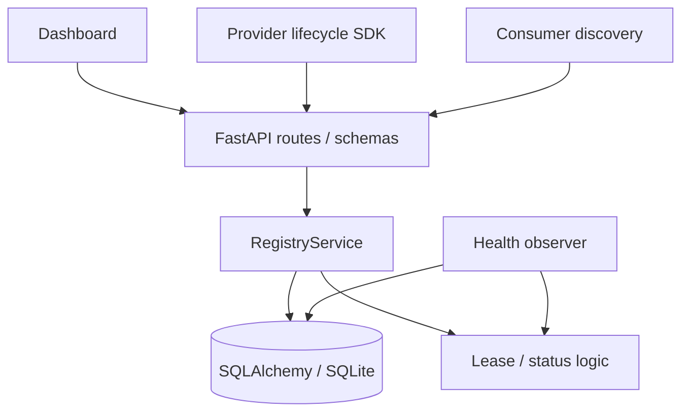
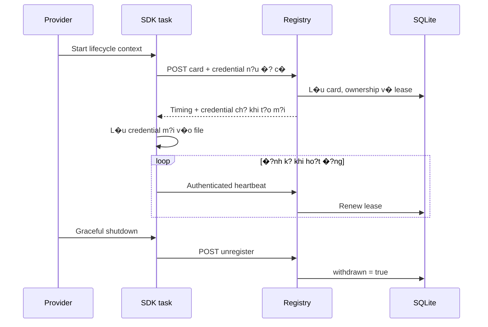
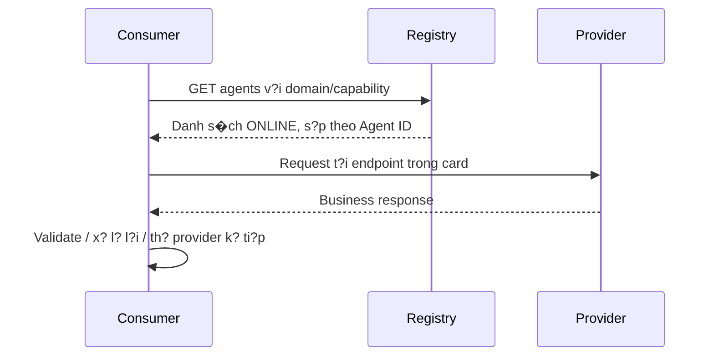

# Architecture

[README](../README.md) � [Registry API](api_contract.md) � [T�ch h?p Agent](agent_integration.md)

## 1. System Context

Nhi?u Provider Agent �?c l?p c?n c�ng b? ch?c n�ng v� �?a ch? truy c?p. Endpoint c� th? �?i khi restart/redeploy; process ho?c k?t n?i m?ng c� th? ng?ng ho?t �?ng. Agent Registry gi? binding t? Agent ID sang endpoint hi?n t?i v� cho consumer discovery theo domain/capability, thay v? hard-code �?a ch? provider.

Trong repository, Weather v� News l� provider minh h?a; Travel v� Planner l� consumer. Kh�ng c?n ��ng k? consumer ch? �? discovery. Registry backend kh�ng ch?a business logic Weather/News.

## 2. Responsibilities and Boundaries

| Th�nh ph?n / kh�i ni?m | Tr�ch nhi?m v� ranh gi?i |
|---|---|
| Agent Registry | L�u card, x�c minh ownership, c?p nh?t binding, suy lu?n tr?ng th�i v� tr? k?t qu? discovery |
| Provider Agent | Ch?y business API, register, t? heartbeat v� c? g?ng unregister khi shutdown |
| Client / Consumer | Discovery, g?i provider tr?c ti?p, ki?m tra output v� x? l? l?i |
| Message Broker | Chuy?n/ph�n ph?i th�ng �i?p; Registry kh�ng l�m vi?c n�y |
| API Gateway | �?ng tr�n ��?ng business request; Registry kh�ng proxy request |
| Observability | Metrics/tracing/gi�m s�t t?ng th?; Registry hi?n ch? c� health endpoint v� log lifecycle |

Discovery t?m metadata/endpoint; invocation th?c hi?n nghi?p v?. Registration th�nh c�ng kh�ng x�c nh?n business API �? ch?y ho?c endpoint reachable.

## 3. Components

| Source | Vai tr? |
|---|---|
| `registry/main.py` | App factory, lifespan, dependency state v� x? l? l?i |
| `registry/routes.py`, `schemas.py` | REST, Bearer extraction, validation v� response models |
| `registry/service.py` | Registration, ownership, mutation, lookup v� discovery |
| `registry/database.py` | ORM model, session/engine, kh?i t?o v� n�ng c?p schema ��n gi?n |
| `registry/leases.py` | Enum v� h�m suy lu?n tr?ng th�i theo clock |
| `registry/health.py` | Observer m?i gi�y �? log thay �?i; kh�ng probe ho?c ghi status |
| `agent_registry_client/` | Lifecycle async; discovery v� invocation helpers synchronous |
| `demo/` | Providers v� consumers �?c l?p v?i Registry backend |
| `registry/dashboard.html` | G?i REST API c�ng origin; polling ch? GET |

Kh�ng c� repository class ri�ng: RegistryService truy c?p SQLAlchemy session tr?c ti?p. Discovery suy lu?n tr?ng th�i l�c �?c n�n kh�ng ph? thu?c observer �? ch?y hay ch�a.

## 4. Core Data Model

**Agent Card + runtime metadata = Registry record.**

| Nh�m | Tr�?ng | ? ngh?a |
|---|---|---|
| Card | `agent_id` | Identity ?n �?nh, duy nh?t, ph�n bi?t hoa th�?ng |
| Card | `name`, `description`, `version` | Th�ng tin m� t? service; version ch�a d�ng �? th��ng l�?ng protocol |
| Card | `domain`, `capabilities` | Nh�m l?nh v?c v� c�c ch?c n�ng d�ng �? discovery |
| Card | `endpoint` | URL operation �?y �?, c� th? �?i m� gi? nguy�n ID |
| Runtime | `registered_at` | Th?i �i?m t?o record �?u ti�n |
| Runtime | `updated_at` | L?n mutation g?n nh?t |
| Runtime | `last_heartbeat` | T�n hi?u register/heartbeat g?n nh?t, t��ng ���ng last_seen |
| Runtime | `lease_expires_at` | H?n lease do Registry t�nh |
| Internal | `withdrawn` | �? r�t registration b?ng unregister |
| Internal | `credential_hash` | Hash c?a credential ownership |

Status ��?c t�nh, kh�ng l�u th�nh c?t. Hash v� withdrawn kh�ng xu?t hi?n trong public AgentView. Timestamp do server t?o, API d�ng UTC timezone-aware; adapter DB kh�i ph?c UTC khi �?c SQLite.

SQLite l�u b?n v?ng qua restart. Startup t?o b?ng n?u thi?u, b? sung c?t `withdrawn` cho schema c? n?u c?n; kh�ng l�m m?i lease ho?c x�a d? li?u. ��y ch�a ph?i h? th?ng migration c� version. Mutation d�ng `BEGIN IMMEDIATE` tr�?c �?c/x�c th?c �? serialize writer SQLite.

## 5. Registration Lifecycle

Context `registered_agent` t?o task n?n r?i tr? quy?n �i?u khi?n ngay, kh�ng �?i ��ng k? th�nh c�ng m?i m? business API. M?i startup g?i card hi?n t?i; re-registration gi? ownership v� registered_at, c?p nh?t binding v� lease. C?u h?nh provider c� th? ghi �� ch?nh s?a card tr�n dashboard ? l?n re-registration sau.

## 6. Discovery and Direct Invocation

Registry kh�ng nh?n th?y business payload. Lookup theo ID c� th? tr? record kh�ng ONLINE; consumer ph?i ph�n bi?t lookup v?i normal discovery. Planner d�ng [common invocation convention](invocation_contract.md); Travel gi? GET Weather c?. C�c demo discovery l?i m?i l�?t, kh�ng cache endpoint.

## 7. Lease and Health State Machine

�?t `age = now - last_heartbeat`. M?c �?nh interval 10s, suspect threshold 20s, TTL 30s; c?u h?nh ph?i th?a `0 < interval < suspect < TTL`.

Th? t? ��nh gi�:

1. withdrawn ? `UNREGISTERED`.
2. now ? lease_expires_at ? `UNREACHABLE`.
3. age ? suspect threshold ? `SUSPECT`.
4. C?n l?i ? `ONLINE`.

Re-registration h?p l? t? b?t k? tr?ng th�i n�o �?u t?o lease m?i. N?u kh�ng �?c/quan s�t gi?a hai ng�?ng, c� th? th?y ONLINE chuy?n th?ng UNREACHABLE. Thi?u m?t heartbeat kh�ng l?p t?c �?ng ngh?a process ch?t.

**Normal discovery ch? tr? ONLINE**, lo?i SUSPECT d� lease c?n h?n. Heartbeat khi SUSPECT c� th? kh�i ph?c ONLINE; heartbeat sau expiry/unregister tr? 409, c?n re-registration. GET, refresh dashboard v� PATCH kh�ng renew lease.

Kh�ng c� active probe. UNREACHABLE ngh?a Registry kh�ng c?n t�n hi?u �? m?i theo lease, kh�ng ph?i b?ng ch?ng process �? ch?t. Provider `/health` ph?c v? ki?m tra tr?c ti?p, kh�ng ��?c Registry t? g?i; ready hi?n l� true v? demo kh�ng c� dependency b�n ngo�i.

## 8. Credential / Ownership

Registry sinh secret ng?u nhi�n 32 byte, tr? m?t l?n, l�u SHA-256. Bearer credential c?a ��ng ID c?n cho re-registration, PATCH, heartbeat, unregister v� DELETE. ID m?i kh�ng c?n credential; ��y ch�a ph?i admission control.

SDK �?c/l�u secret ? file ri�ng, t?o file m?i b?ng exclusive create. Quy?n 0600 ��?c y�u c?u khi t?o; tr�n Windows c?n b?o v? ACL th� m?c. Kh�ng log secret, kh�ng d�ng credential Registry �? x�c th?c business API. M?t kh�a ho?c m?t response c?p kh�a �?u ti�n ch�a c� c� ch? ph?c h?i/rotation.

Unregister gi? record v� ownership. DELETE x�a c? record/hash, gi?i ph�ng ID. Dashboard hi?n g?i DELETE khi ng�?i d�ng ch?n �H?y ��ng k?�; ��ng browser kh�ng g?i thao t�c n�o trong hai thao t�c n�y.

## 9. Failure and Recovery

| T?nh hu?ng | Behavior hi?n t?i |
|---|---|
| Crash / m?t m?ng provider | Heartbeat ng?ng; tr?ng th�i theo th?i gian chuy?n SUSPECT r?i UNREACHABLE |
| Registry unavailable | Business API v?n ch?y; SDK retry l?i m?ng, 408/429/5xx v?i exponential backoff v� jitter |
| Registry ph?c h?i | Heartbeat ti?p n?u lease c?n h?n; 409 chuy?n sang authenticated re-registration |
| Endpoint �?i | D?ng process c?, gi? ID/credential, �?i c?u h?nh endpoint v� �?a ch? bind, restart |
| Graceful shutdown | H?y task r?i c? g?ng unregister, deadline 4s; kh�ng g?i ��?c th? lease t? h?t |
| 401/403/404/422 ho?c l?i 4xx kh�ng retry | SDK d?ng lifecycle, state operator_required; business server kh�ng t? d?ng |
| File credential kh�ng �?c/l�u ��?c | SDK y�u c?u operator x? l?, kh�ng t? x�a kh�a/chi?m l?i ID |

Retry t?i �a m?i kho?ng backoff ��?c c?u h?nh b?ng `AGENT_RETRY_MAX_SECONDS` ? demo; kh�ng ph?i s? l?n retry t?i �a. Response timing/JSON kh�ng h?p l? c?ng ��?c retry. Startup Registry v?i DB c? gi? expiry; DB b? m?t kh�c ho�n to�n restart b?nh th�?ng.

## 10. Design Decisions

- **Derived status:** tr�nh status persist b? c?; c�ng logic ��?c d�ng cho response v� observer.
- **Kh�ng active probing:** Registry kh�ng g?i request t?i endpoint t�y ?; ��nh �?i l� kh�ng ki?m ch?ng business readiness.
- **Direct invocation:** l?i nghi?p v? v� protocol provider n?m ngo�i Registry.
- **Full endpoint:** consumer kh�ng ph?i t? n?i path; nhi?u capability c?a demo d�ng chung m?t dispatcher endpoint.
- **SQLite:** gi?m y�u c?u tri?n khai cho project; writer ��?c serialize, ch�a c� benchmark t?i.
- **Convention ngo�i Registry:** backend l�u metadata t?ng qu�t, c?n input/output schema do provider v� consumer th?a thu?n.

## 11. Known Limitations

Ch�a c� instance_id/fencing: ch? ch?y m?t process cho m?i ID/credential; process c? c� th? heartbeat ho?c unregister registration m?i. Ch�a pagination, index capability, replication hay migration runner �?y �?; capability ��?c l?c trong ?ng d?ng v� observer qu�t danh s�ch m?i gi�y.

Lease ph? thu?c wall-clock c?a Registry. Kh�ng c� t�i kho?n admin, gi?i h?n t?n su?t hay c� ch? ph?c h?i credential. Common invocation kh�ng t? m� t? m?i Agent; failover operation c� side effect c?n thi?t k? idempotency ri�ng. Travel ch? ki?m tra HTTP/JSON, c?n Planner validate business output.

LAN, browser th?t, t�ch h?p nh�m ngo�i v� t?i production ch�a ��?c ch?ng minh b?i unit test ho?c loopback smoke. Xem [Verification](verification.md) �? bi?t ph?m vi �? th?c thi.

