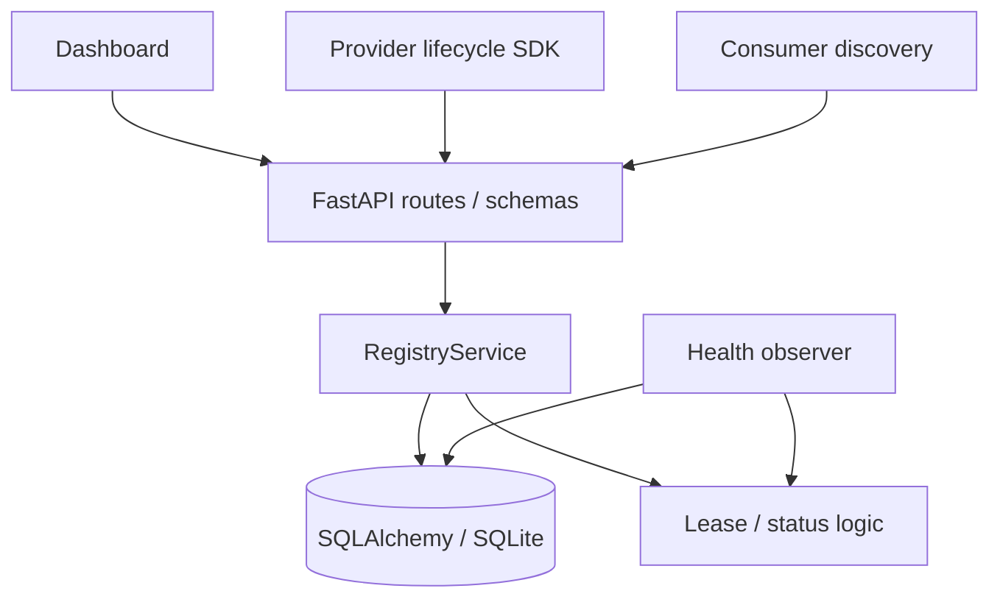
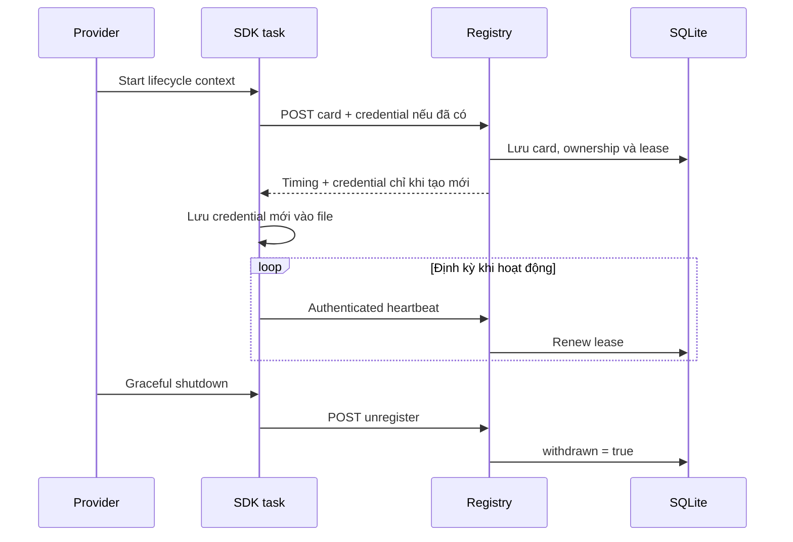
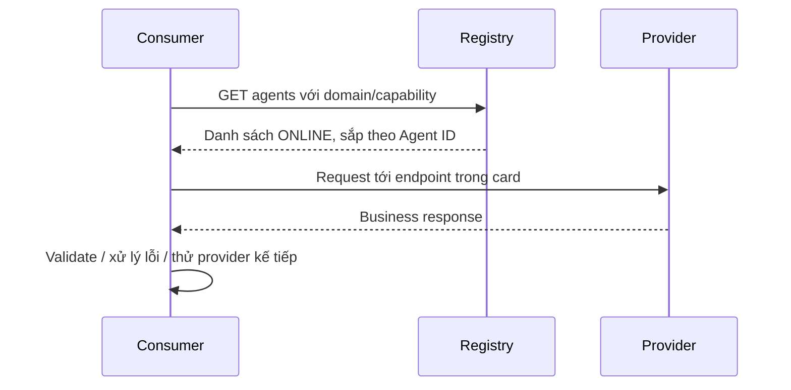
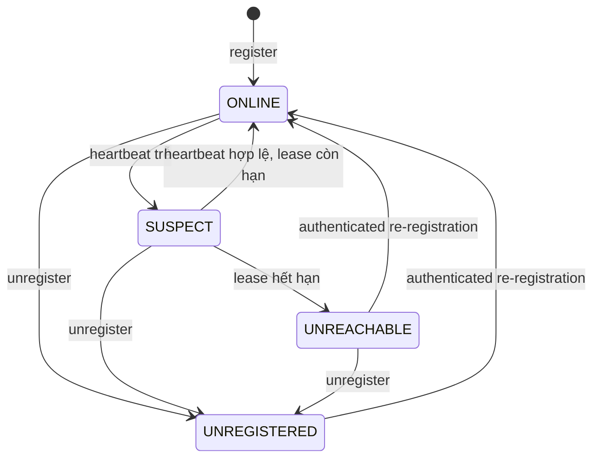

# Architecture

[README](../README.md) · [Registry API](api_contract.md) · [Tích hợp Agent](agent_integration.md)

## 1. System Context

Nhiều Provider Agent độc lập cần công bố chức năng và địa chỉ truy cập. Endpoint có thể đổi khi restart/redeploy; process hoặc kết nối mạng có thể ngừng hoạt động. Agent Registry giữ binding từ Agent ID sang endpoint hiện tại và cho consumer discovery theo domain/capability, thay vì hard-code địa chỉ provider.

Trong repository, Weather và News là provider minh họa; Travel và Planner là consumer. Không cần đăng ký consumer chỉ để discovery. Registry backend không chứa business logic Weather/News.

## 2. Responsibilities and Boundaries

| Thành phần / khái niệm | Trách nhiệm và ranh giới |
|---|---|
| Agent Registry | Lưu card, xác minh ownership, cập nhật binding, suy luận trạng thái và trả kết quả discovery |
| Provider Agent | Chạy business API, register, tự heartbeat và cố gắng unregister khi shutdown |
| Client / Consumer | Discovery, gọi provider trực tiếp, kiểm tra output và xử lý lỗi |
| Message Broker | Chuyển/phân phối thông điệp; Registry không làm việc này |
| API Gateway | Đứng trên đường business request; Registry không proxy request |
| Observability | Metrics/tracing/giám sát tổng thể; Registry hiện chỉ có health endpoint và log lifecycle |

Discovery tìm metadata/endpoint; invocation thực hiện nghiệp vụ. Registration thành công không xác nhận business API đã chạy hoặc endpoint reachable.

## 3. Components

| Source | Vai trò |
|---|---|
| `registry/main.py` | App factory, lifespan, dependency state và xử lý lỗi |
| `registry/routes.py`, `schemas.py` | REST, Bearer extraction, validation và response models |
| `registry/service.py` | Registration, ownership, mutation, lookup và discovery |
| `registry/database.py` | ORM model, session/engine, khởi tạo và nâng cấp schema đơn giản |
| `registry/leases.py` | Enum và hàm suy luận trạng thái theo clock |
| `registry/health.py` | Observer mỗi giây để log thay đổi; không probe hoặc ghi status |
| `agent_registry_client/` | Lifecycle async; discovery và invocation helpers synchronous |
| `demo/` | Providers và consumers độc lập với Registry backend |
| `registry/dashboard.html` | Gọi REST API cùng origin; polling chỉ GET |

Không có repository class riêng: RegistryService truy cập SQLAlchemy session trực tiếp. Discovery suy luận trạng thái lúc đọc nên không phụ thuộc observer đã chạy hay chưa.

## 4. Core Data Model

**Agent Card + runtime metadata = Registry record.**

| Nhóm | Trường | Ý nghĩa |
|---|---|---|
| Card | `agent_id` | Identity ổn định, duy nhất, phân biệt hoa thường |
| Card | `name`, `description`, `version` | Thông tin mô tả service; version chưa dùng để thương lượng protocol |
| Card | `domain`, `capabilities` | Nhóm lĩnh vực và các chức năng dùng để discovery |
| Card | `endpoint` | URL operation đầy đủ, có thể đổi mà giữ nguyên ID |
| Runtime | `registered_at` | Thời điểm tạo record đầu tiên |
| Runtime | `updated_at` | Lần mutation gần nhất |
| Runtime | `last_heartbeat` | Tín hiệu register/heartbeat gần nhất, tương đương last_seen |
| Runtime | `lease_expires_at` | Hạn lease do Registry tính |
| Internal | `withdrawn` | Đã rút registration bằng unregister |
| Internal | `credential_hash` | Hash của credential ownership |

Status được tính, không lưu thành cột. Hash và withdrawn không xuất hiện trong public AgentView. Timestamp do server tạo, API dùng UTC timezone-aware; adapter DB khôi phục UTC khi đọc SQLite.

SQLite lưu bền vững qua restart. Startup tạo bảng nếu thiếu, bổ sung cột `withdrawn` cho schema cũ nếu cần; không làm mới lease hoặc xóa dữ liệu. Đây chưa phải hệ thống migration có version. Mutation dùng `BEGIN IMMEDIATE` trước đọc/xác thực để serialize writer SQLite.

## 5. Registration Lifecycle

Context `registered_agent` tạo task nền rồi trả quyền điều khiển ngay, không đợi đăng ký thành công mới mở business API. Mỗi startup gửi card hiện tại; re-registration giữ ownership và registered_at, cập nhật binding và lease. Cấu hình provider có thể ghi đè chỉnh sửa card trên dashboard ở lần re-registration sau.

## 6. Discovery and Direct Invocation

Registry không nhìn thấy business payload. Lookup theo ID có thể trả record không ONLINE; consumer phải phân biệt lookup với normal discovery. Planner dùng [common invocation convention](invocation_contract.md); Travel giữ GET Weather cũ. Các demo discovery lại mỗi lượt, không cache endpoint.

## 7. Lease and Health State Machine

Đặt `age = now - last_heartbeat`. Mặc định interval 10s, suspect threshold 20s, TTL 30s; cấu hình phải thỏa `0 < interval < suspect < TTL`.

Thứ tự đánh giá:

1. withdrawn → `UNREGISTERED`.
2. now ≥ lease_expires_at → `UNREACHABLE`.
3. age ≥ suspect threshold → `SUSPECT`.
4. Còn lại → `ONLINE`.

Re-registration hợp lệ từ bất kỳ trạng thái nào đều tạo lease mới. Nếu không đọc/quan sát giữa hai ngưỡng, có thể thấy ONLINE chuyển thẳng UNREACHABLE. Thiếu một heartbeat không lập tức đồng nghĩa process chết.

**Normal discovery chỉ trả ONLINE**, loại SUSPECT dù lease còn hạn. Heartbeat khi SUSPECT có thể khôi phục ONLINE; heartbeat sau expiry/unregister trả 409, cần re-registration. GET, refresh dashboard và PATCH không renew lease.

Không có active probe. UNREACHABLE nghĩa Registry không còn tín hiệu đủ mới theo lease, không phải bằng chứng process đã chết. Provider `/health` phục vụ kiểm tra trực tiếp, không được Registry tự gọi; ready hiện là true vì demo không có dependency bên ngoài.

## 8. Credential / Ownership

Registry sinh secret ngẫu nhiên 32 byte, trả một lần, lưu SHA-256. Bearer credential của đúng ID cần cho re-registration, PATCH, heartbeat, unregister và DELETE. ID mới cần join token của Registry. Service kiểm tra admission trong cùng giao dịch ghi SQLite với việc tra ID; chỉ cấp ownership credential sau khi admission thành công.

SDK đọc/lưu secret ở file riêng, tạo file mới bằng exclusive create. Quyền 0600 được yêu cầu khi tạo; trên Windows cần bảo vệ ACL thư mục. Không log secret, không dùng credential Registry để xác thực business API. Mất khóa hoặc mất response cấp khóa đầu tiên chưa có cơ chế phục hồi/rotation.

Unregister giữ record và ownership. DELETE xóa cả record/hash, giải phóng ID. Dashboard hiện gọi DELETE khi người dùng chọn “Hủy đăng ký”; đóng browser không gọi thao tác nào trong hai thao tác này.

## 9. Failure and Recovery

| Tình huống | Behavior hiện tại |
|---|---|
| Crash / mất mạng provider | Heartbeat ngừng; trạng thái theo thời gian chuyển SUSPECT rồi UNREACHABLE |
| Registry unavailable | Business API vẫn chạy; SDK retry lỗi mạng, 408/429/5xx với exponential backoff và jitter |
| Registry phục hồi | Heartbeat tiếp nếu lease còn hạn; 409 chuyển sang authenticated re-registration |
| Endpoint đổi | Dừng process cũ, giữ ID/credential, đổi cấu hình endpoint và địa chỉ bind, restart |
| Graceful shutdown | Hủy task rồi cố gắng unregister, deadline 4s; không gửi được thì lease tự hết |
| 401/403/404/422 hoặc lỗi 4xx không retry | SDK dừng lifecycle, state operator_required; business server không tự dừng |
| File credential không đọc/lưu được | SDK yêu cầu operator xử lý, không tự xóa khóa/chiếm lại ID |

Retry tối đa mỗi khoảng backoff được cấu hình bằng `AGENT_RETRY_MAX_SECONDS` ở demo; không phải số lần retry tối đa. Response timing/JSON không hợp lệ cũng được retry. Startup Registry với DB cũ giữ expiry; DB bị mất khác hoàn toàn restart bình thường.

## 10. Design Decisions

- **Derived status:** tránh status persist bị cũ; cùng logic được dùng cho response và observer.
- **Không active probing:** Registry không gửi request tới endpoint tùy ý; đánh đổi là không kiểm chứng business readiness.
- **Direct invocation:** lỗi nghiệp vụ và protocol provider nằm ngoài Registry.
- **Full endpoint:** consumer không phải tự nối path; nhiều capability của demo dùng chung một dispatcher endpoint.
- **SQLite:** giảm yêu cầu triển khai cho project; writer được serialize, chưa có benchmark tải.
- **Convention ngoài Registry:** backend lưu metadata tổng quát, còn input/output schema do provider và consumer thỏa thuận.

## 11. Known Limitations

Chưa có instance_id/fencing: chỉ chạy một process cho mỗi ID/credential; process cũ có thể heartbeat hoặc unregister registration mới. Chưa pagination, index capability, replication hay migration runner đầy đủ; capability được lọc trong ứng dụng và observer quét danh sách mỗi giây.

Lease phụ thuộc wall-clock của Registry. Không có tài khoản admin, giới hạn tần suất hay cơ chế phục hồi credential. Common invocation không tự mô tả mọi Agent; failover operation có side effect cần thiết kế idempotency riêng. Travel chỉ kiểm tra HTTP/JSON, còn Planner validate business output.

LAN, browser thật, tích hợp nhóm ngoài và tải production chưa được chứng minh bởi unit test hoặc loopback smoke. Xem [Verification](verification.md) để biết phạm vi đã thực thi.
