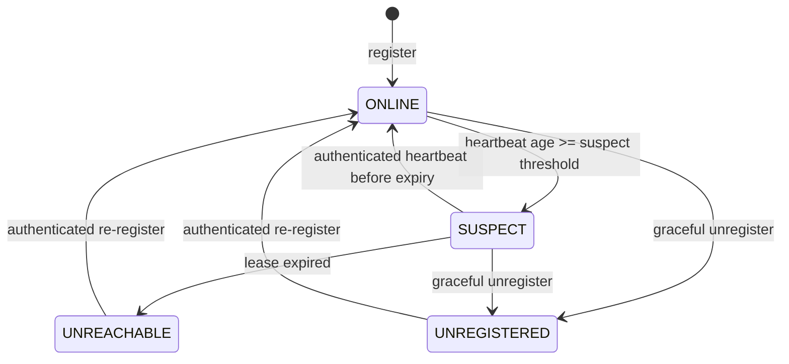
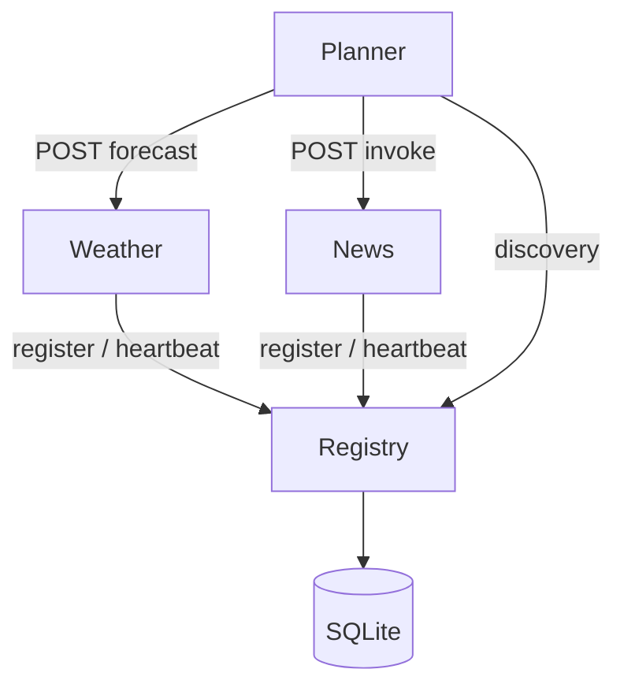

# Kiến trúc lifecycle

HTTP routes + Pydantic → RegistryService → SQLAlchemy SQLite. Clock UTC được inject cho test, trạng thái tính khi đọc. Health observer mỗi giây chỉ log chuyển trạng thái, không ghi status vào DB và không quyết định độ đúng của discovery.

AgentRegistryClient (demo/registry_client.py) dùng httpx async, được Weather tạo trong lifespan. Task background register trước, sau đó heartbeat theo interval Registry trả về. Service forecast tiếp tục hoạt động khi Registry lỗi. Travel hỏi Registry rồi gọi provider trực tiếp.

## State machine

Nếu clock tiến thẳng qua nhiều ngưỡng, trạng thái đọc được có thể chuyển thẳng ONLINE → UNREACHABLE. Không cần từng transition được observer chạy qua. Missing một heartbeat không lập tức kết luận offline. ONLINE là tín hiệu gần đây, không bảo đảm endpoint reachable từ mọi client.

Không active probe endpoint tùy ý. Đây là lựa chọn giữ nguyên boundary bảo mật của repo. Vì vậy tiêu chí “lease hết + probe fail” được triển khai thành “lease hết, không có bằng chứng heartbeat mới”; không có log giả rằng đã probe. Health endpoint Weather cho operator kiểm tra trực tiếp. DEGRADED chưa có vì không có dependency forecast thật.

## Identity, binding và dữ liệu

Agent ID ổn định; endpoint động; domain nhóm lĩnh vực; capabilities tiêu chí discovery. POST register có khóa cũ cập nhật binding và renew lease; PATCH không renew. Status dùng enum chung trong leases.py/schema/service. last_heartbeat chính là last_seen, không thêm cột trùng.

Thêm withdrawn BOOLEAN NOT NULL DEFAULT 0, migration additive lúc startup. Không thay timestamp, hash hay xóa DB cũ. Migration chạy khi chỉ một Registry khởi động; chưa có migration runner nhiều phiên bản. Không lưu status dễ stale. Graceful POST unregister giữ identity và khóa; DELETE là xóa vĩnh viễn. Hai thao tác khác nhau có chủ ý để bảo toàn compatibility DELETE cũ.

## Retry và shutdown

Lỗi mạng, 408/429/5xx: retry exponential backoff có jitter, tối đa AGENT_RETRY_MAX_SECONDS (10s). Heartbeat 409 chuyển ngay sang authenticated register. 401/403/404 và các lỗi 4xx cố định: dừng lifecycle, health registration=operator_required; business API tiếp tục. Không tự chiếm ID khi database mất hoặc operator xóa record. Interval bình thường do Registry trả về, retry không đổi TTL của Registry.

Ctrl+C hủy task trước rồi unregister với deadline 4s. Nếu request không tới Registry thì lease hết theo clock. Crash bỏ qua toàn bộ cleanup: heartbeat mất, SUSPECT rồi UNREACHABLE. Reconnect với DB cũ giữ nguyên credential. File khóa lưu trước khi xem đăng ký thành công; server chỉ giữ SHA-256 của secret ngẫu nhiên 256 bit, không log secret.

## Giới hạn có chủ ý

Chưa có incarnation/fencing; một process/ID/credential, không chạy --workers nhiều hoặc hai bản sao đồng thời. Thêm instance_id cần bảo vệ cả heartbeat lẫn unregister/PATCH, quy tắc chuyển quyền giữa các incarnation, không chỉ thêm UUID vào JSON.

Không bảo đảm phục hồi response cấp credential bị thất lạc, không key rotation/admin account. Web đăng ký không tự cấp khóa vào service; operator phải lưu đúng file và cấu hình service. Web không gửi heartbeat; GET polling không renew. Điều chỉnh Card trên web có thể bị cấu hình service ghi đè khi re-register.

Test: fake clock cho boundary, MockTransport cho lỗi mạng, TestClient cho API, process/HTTP thật cho smoke. Không tuyên bố kiểm chứng LAN, cross-team hoặc browser E2E.

## Generic integration (16/11/2026)

Registry backend và schema DB giữ nguyên. SDK public: agent_registry_client, import legacy còn hỗ trợ. Weather GET /forecast giữ nguyên, thêm POST /forecast common envelope. News POST /invoke hỗ trợ search_news/summarize_news deterministic. Planner tách discover → invoke_first → build_plan, validate identity/capability/business output, failover, trả kết quả partial khi một capability lỗi. Registry không proxy business traffic. Contract và ví dụ REST/SDK/LAN đầy đủ: [agent_integration.md](agent_integration.md).

